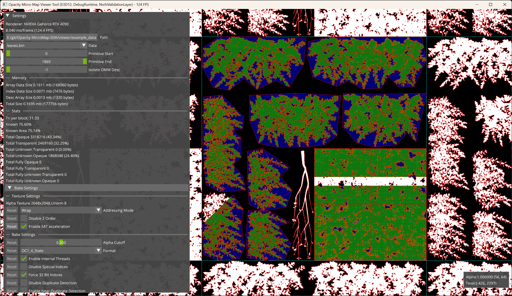
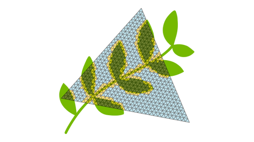
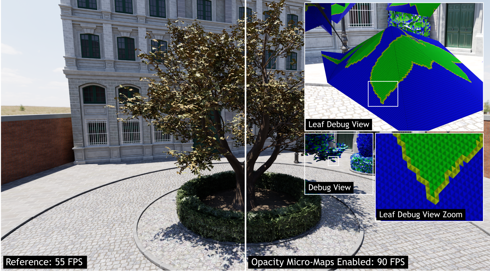

[](https://github.com/NVIDIAGameWorks/Opacity-MicroMap-SDK/actions/workflows/build.yml)

# New in 1.10.0: ARM64 support

- Added ARM64 support.
- Fixed shader compilation when cross-compiling.
- Added configurable BMI2 optimizations for x86-64.
- Improved microtriangle inlining and bounds calculation.
- Fixed degenerate UV triangle detection and NaN/Inf handling during fast-math CPU baking.
- Fixed GCC fast-math regressions in UV interpolation and contour intersections.
- Added regression tests for bit operations, UV validation, degenerate triangles, and axis-aligned line rasterization.
- Enabled fast-math optimizations for GCC.
- Updated dependencies and raised the minimum CMake version to 4.1.

# New in 1.8.0: Official DXR 1.2 support

Check out the sample app at [https://github.com/NVIDIA-RTX/OMM-Samples](https://github.com/NVIDIA-RTX/OMM-Samples) for a demonstration of OMM SDK usage with DXR 1.2 and Agility SDK version 1.616.

# New in 1.7.0: Opacity Micro-Map Viewer Tool

Version 1.7.0 introduces the new Opacity Micro-Map Viewer Tool
<p align="center">
    
</p>

Use the new serialization API to view your OMM assets and experiment with different bake settings to achive optimal performance and quality trade-offs. You can view and inspect your existing assets, zoom down to the micro-triangle level all the way out to the macro-triangle scale, highlights specific triangles, understand OMM block re-use and much more. 

# Runnable Samples
Get the OMM SDK demo app: [https://github.com/NVIDIAGameWorks/Opacity-MicroMap-Samples](https://github.com/NVIDIAGameWorks/Opacity-MicroMap-Samples)

Or check out it's use in Path Tracing SDK: [https://github.com/NVIDIAGameWorks/Path-Tracing-SDK](https://github.com/NVIDIAGameWorks/Path-Tracing-SDK)

# Useful resources
- See [Micro-Mesh Basics slides](https://developer.download.nvidia.com/ProGraphics/nvpro-samples/slides/Micro-Mesh_Basics.pdf) for an introduction to Micro-Meshes
- See [Nsight Graphics 2023.1 - Release Spotlight](https://youtu.be/xGAs9guQtPE) for a demo of the Opacity Micro-Map viewer in Nsight Graphics 2023.1
- See [Getting Started with Compressed Micro-Meshes](https://register.nvidia.com/flow/nvidia/gtcspring2023/attendeeportal/page/sessioncatalog/session/1666430278669001BFSR) NVIDIA GTC 2023 presentation
- See [NVIDIA ADA GPU ARCHITECTURE - 2x Faster Alpha Traversal Performance with Opacity Micromap Engine](https://images.nvidia.com/aem-dam/Solutions/geforce/ada/nvidia-ada-gpu-architecture.pdf) for a technical overview of Opacity Micro-Maps and how they can help accelerate raytracing workloads.
- See [NVIDIA Ray Tracing Micro-Mesh](https://developer.nvidia.com/rtx/ray-tracing/micro-mesh) for latest news on Micro-Maps and Micro-Meshes.
- See [NVAPI 520 (or later)](https://developer.nvidia.com/rtx/path-tracing/nvapi/get-started) for details on the Opacity Micro-Maps extension for D3D12.
- See [VK_EXT_opacity_micromap](https://github.com/KhronosGroup/Vulkan-Docs/blob/main/chapters/VK_EXT_opacity_micromap/micromaps.adoc) for details on the Opacity Micro-Maps extension for Vulkan.
- See [NVIDIA OptiX](https://developer.nvidia.com/designworks/optix/download) and the [NVIDIA OptiX Programming Guide](https://raytracing-docs.nvidia.com/optix7/guide/index.html#acceleration_structures#accelstruct-omm) which goes in to more detail on the internal layout of the Opacity Micro-Map data format.

# Opacity Micro-Map SDK

<p align="center">
    
    
</p>

The images above illustrate Any Hit Shader (AHS) shader invocations without OMMs (left) and with a 4-state OMM produced by the SDK (right).

<p align="center">
    
</p>
Path tracing with OMMs enabled on alpha tested vegetation. Micro triangles are visible in the debug view, blue = transparent, green = opaque, yellow = unknown. Captured on an RTX 4090 (4K ~3.25 rpp).

## Overview
Opacity Micro-Maps (OMMs) are used to accelerate raytracing of high detail geometry by efficiently encoding the opacity states of micro-triangles and micro meshes. This technology encodes the opacity of micro-triangles and makes it possible to trace rays, at high performance, extremely detailed scene elements such as vegetation and foliage. Traditionally high detail opacity information is constructed via alpha textures, however, for raytracing this normally involves costly alpha evaluation in shaders to generate the desired result. Opacity Micro-Maps is a solution that can either remove the need for shader invocations entirely (by approximating the original geometry), or drastically reduce the number required of shader invocations without any loss in quality. OMMs will generally be an accelerator for applications that have traditional alpha testing or alpha blending as part of the raytracing workloads.

Opacity Micro-Maps is supported for raytracing in D3D12 (via NvAPI), VK and NVIDIA OptiX. For details on the data-structures and API usage please see [prerequisites](#prerequisites-and-useful-resources) for links and details.

## SDK Description
Opacity Micro-Map SDK is used to automatically convert existing alpha tested or alpha blended assets to opacity micro-maps without the need to manually convert existing, or author new, content. The asset-to-OMM conversion is done entirely by the SDK by parsing and analyzing the existing alpha texture and geometry to produce highly optimized and efficient OMM data ready direct for consumption by D3D12 or VK. The conversion can either be done at runtime, by the GPU baker, or offline by the CPU baker when pre-processing of assets is more practical. Which version to use depends on the user requirements, capabilities of the build infrastructure and title content. The GPU backend is designed to be executed by the client RHI on either D3D12 or VK. See the SDK integration guide for more in depth discussion. 

## Integration Guide
To read more about OMMs, the SDK and practical integration tips please see the [integration guide](docs/integration_guide.md).

# Sample Application(s)

## Opacity Micro-Map Samples
A full features sample application using the OMM SDK can be found here: *[Opacity-MicroMap-Samples](https://github.com/NVIDIAGameWorks/Opacity-MicroMap-Samples)*.

The sample demonstrates all features of the SDK, running on D3D12 or Vulkan with both GPU and CPU baking toggleable. The sample app runs raytracing with primary rays with specular and diffuse reflections with a configurable number of bounces. Use the UI to tweak the OMM format, subdivision level and other baking parameters. The sample includes a caching mechanism that is meant to illustrate the use of prebaked OMM data.

## Path Tracing SDK
Additionally the OMM SDK GPU baker is integrated in to the Path Tracing SDK: *[https://github.com/NVIDIAGameWorks/Path-Tracing-SDK](https://github.com/NVIDIAGameWorks/Path-Tracing-SDK)*.

# Build Instructions

Requires CMake 4.1 or newer.

## SDK Usage on Windows

1. Clone the repository with all submodules:
	- `git clone --recursive https://github.com/NVIDIAGameWorks/Opacity-MicroMap-SDK.git`

	If the clone was made non-recursively and the submodules are missing, clone them separately:

	- `git submodule update --init --recursive`
	
2. Configure the solution with CMake. The easiest option is to use [CMake GUI](https://cmake.org/download/).

3. Assuming that the OMM Bake SDK tree is located in `D:\Opacity-MicroMap-SDK`, set the following parameters in the GUI:
	- "Where is the source code" to `D:\Opacity-MicroMap-SDK`
	- "Where to build the binaries" to `D:\Opacity-MicroMap-SDK\build`

5. Click "Configure", set "Generator" to the Visual Studio you're using (tested with VS 2022 version 17.2.5), set "Optional platform" to x64, click "Finish".

6. Click "Generate", then "Open Project".

7. Build the solution with Visual Studio 

8. Either run the `INSTALL` project to generate header and binaries that can be linked to your project, or configure with `OMM_ENABLE_TESTS=ON` and run `Tests` to run the unit tests.

9. If running ``INSTALL`` the following binaries will be generated in the cmake output folder which can be used to link to the client application.
```
%cmake output dir%
└───install
    └───include
    |   └─── omm.h
    └───lib
    │   └─── omm-sdk.lib
    └───bin
        └─── omm-sdk.dll
```
10. If running `Tests` and CMake have been configured with `-DOMM_TEST_ENABLE_IMAGE_DUMP` a folder with image files will be located in `D:\Opacity-MicroMap-SDK\build\tests\OmmBakeOutput` and  `D:\Opacity-MicroMap-SDK\build\tests\OmmBakeOutput_GPU`

## CPU bake benchmark

The `omm-cpu-benchmark` command-line tool bakes the bundled `assets/omm_example_data/leaves.bin` using its serialized settings. It requires only the CPU SDK library and can be built with the viewer and tests disabled.

```powershell
cmake -S . -B build -DOMM_BUILD_BENCHMARK=ON
cmake --build build --config Release --target omm-cpu-benchmark
.\build\bin\Release\omm-cpu-benchmark.exe --iterations 5 --warmup 1
```

Each iteration bakes every input in the blob. The tool prints individual times and minimum, median, mean, and maximum bake time. File loading, deserialization, warmup, and result destruction are excluded from the measurements. Use `--threads on` or `--threads off` to override internal threading, or `--input PATH` to benchmark another serialized blob. Otherwise the saved bake settings are preserved. Run `--help` for all options. Build with `-DOMM_BUILD_BENCHMARK=OFF` to omit the tool.

Use `--subdivision N` (0 through 12) to force a uniform subdivision level for an experiment. This overrides the saved subdivision cap, disables dynamic level selection and ignores saved per-triangle subdivision levels. The source blob is unchanged. Each additional level quadruples the number of microtriangles.

Use `--target-area N` to select area mode with a target of `N` square texels per microtriangle, or `--target-edge N` to select edge mode with a target longest microtriangle edge of `N` texture texels. Targets must be finite and positive. These options preserve the saved maximum level and CPU per-triangle overrides and are mutually exclusive with each other and `--subdivision`. Area mode retains the saved effective edge target for degenerate UV triangles.

## GPU bake benchmark

The `omm-gpu-benchmark` command-line tool uses the SDK's NVRHI integration to bake the same serialized inputs on a Direct3D 12 hardware adapter. It is built alongside the CPU benchmark on Windows when `omm-gpu-nvrhi`, `nvrhi_d3d12` and embedded DXIL shaders are available. It runs without a window or the viewer. The GPU benchmark requires `OMM_GPU_REFERENCE_MODE=OFF`; the build asserts this setting.

```powershell
cmake -S . -B build -DOMM_BUILD_BENCHMARK=ON
cmake --build build --config Release --target omm-gpu-benchmark
.\build\bin\Release\omm-gpu-benchmark.exe --iterations 5 --warmup 1
.\build\bin\Release\omm-gpu-benchmark.exe --input "E:\OpacityMicroMap_Data" --iterations 5 --warmup 1
.\build\bin\Release\omm-gpu-benchmark.exe --input "E:\OpacityMicroMap_Data" --limit 20 --selection strided
.\build\bin\Release\omm-gpu-benchmark.exe --input "E:\OpacityMicroMap_Data" --limit 20 --selection random --seed 42
.\build\bin\Release\omm-gpu-benchmark.exe --input "E:\OpacityMicroMap_Data" --limit 20 --selection random --seed 42 --target-edge 8
```

For a build without the viewer or tests, configure with `-DOMM_BUILD_VIEWER=OFF -DOMM_ENABLE_TESTS=OFF -DOMM_INTEGRATION_LAYER_NVRHI=ON -DOMM_BUILD_OMM_GPU_NVRHI=ON -DOMM_ENABLE_PRECOMPILED_SHADERS_DXIL=ON`. The `external/donut/nvrhi` submodule must be present. Set `-DOMM_BUILD_GPU_BENCHMARK=OFF` to build only the CPU benchmark, or `-DOMM_BUILD_BENCHMARK=OFF` to omit both tools. Configurations without the GPU dependencies skip the GPU target and retain the CPU benchmark.

Each iteration bakes every input in the blob and sums GPU timestamp durations around the full `SetupAndBake` dispatch. The tool prints the selected GPU, individual iterations, minimum, median, mean and maximum times, and output micromap and array byte counts. Device creation, deserialization, input uploads, resource allocation on the CPU, command recording, waiting and output readback are excluded. Resources are reused across iterations; these measurements do not include building a hardware opacity micromap or acceleration structure.

Use `--input PATH` to select a serialized `.bin` file or a directory. Directory inputs recursively discover `.bin` files (case-insensitive extension) into a stable, sorted path list before selection. A batch reuses one GPU device and loads and releases one file at a time. Each file gets its own warmup and measured iterations and results. The batch summary reports the sum of per-file median GPU times; this is not a measured median of complete batch runs. Failed files are reported and processing continues; any failure makes the command exit with a nonzero code.

Use `--limit N` to cap the selected files; the default is all files. Failed files still count toward the limit. `--selection first|strided|random` controls selection:

- `first` (default) takes files from the start of the sorted list.
- `strided` selects evenly spaced files across the entire sorted list, including the first and last when selecting more than one file, or the middle file when selecting one. Without a limit, it selects all files.
- `random` shuffles the sorted list and selects files without replacement. Its seed defaults to zero; use `--seed N` with `--selection random` to change it. The same file list and seed produce the same selection.

Selection applies to the whole discovered list. Select a project subdirectory, such as `E:\OpacityMicroMap_Data\AW2`, to restrict the input project.

The benchmark uses compute shaders throughout by default. Use `--subdivision N` to force uniform subdivision (0 through 12), or `--graphics` to select the graphics/compute path (subdivision 0 through 9). `--debug` enables D3D12 and NVRHI validation for diagnosis and affects performance. Run `--help` for all options.

Use `--target-area N` or `--target-edge N` to choose explicit subdivision targets in square texels or texels, respectively. Smaller targets give finer subdivision and typically larger OMMs; larger targets give coarser subdivision. The saved maximum level still applies. For example, `--target-edge 8` requests a longest microtriangle edge of 8 texture texels: a 64-texel parent edge requires level 3, giving 64 microtriangles. There is no implicit multiplier. Doubling an edge target usually removes one level and quarters the microtriangle count until a level limit is reached. The target options are mutually exclusive with each other and `--subdivision`.

Without an override, the benchmark preserves the serialized subdivision mode and settings. The deprecated `dynamicSubdivisionScale` is used only in `Legacy` mode; see [Subdivision Level](docs/integration_guide.md#subdivision-level) for migration examples.

Area mode targets microtriangle area in square texels and uses its independent edge target for degenerate UV triangles. Edge mode targets the longest microtriangle edge and is recommended for better results on long, thin UV triangles: it preserves opacity detail along their length even when their area is small. This may increase bake time and output memory. Triangle shape can produce different levels in the two modes, so similar output memory does not imply equivalent opacity coverage.

The GPU baker supports a single texture mip and alpha testing. Unsupported saved settings, including per-triangle formats or subdivision levels, are reported as errors; `--subdivision` replaces saved subdivision levels. CPU-only settings that cannot be applied are reported as warnings. GPU and CPU baking use different algorithms and may produce different outputs, including different unknown-state promotion and deduplication results. Timing comparisons should account for those differences.

## CMake options
`-DOMM_STATIC_LIBRARY=ON` - Will configure the omm-sdk project as either a SHARED (OFF) or STATIC (ON) target in CMake. 

`-DOMM_ENABLE_PRECOMPILED_SHADERS_DXIL=ON` - Enable this when using the GPU baker with precompiled shaders in D3D12. The DXIL will be part of the generated library files (.dll) and can be used direct to create the nessesary pipeline state objects at runtime. May get disabled if Windows SDK is not found on the system. Required to run GPU Unit Test.

`-DOMM_ENABLE_PRECOMPILED_SHADERS_SPIRV=ON` - Enable this when using the GPU baker with precompiled shaders in Vulkan. The SPIRV will be part of the generated library files (.dll) and can be used direct to create the nessesary pipeline state objects at runtime. This may get disabled if Vulkan SDK is not found on the system.

`-DOMM_USE_RAW_INDEX_BUFFER=ON` - Use a raw `ByteAddressBuffer` for GPU input indices, with software unpacking of 8-bit, 16-bit, and 32-bit indices. Defaults to `OFF`, which uses a typed `Buffer<uint>`. Applies to embedded DXIL and SPIR-V shaders and their resource descriptions. See [GPU input index buffers](docs/integration_guide.md#gpu-input-index-buffers) for custom shader integration.

`-DOMM_ENABLE_BMI2=ON` - Enable BMI2 optimizations for x86-64 targets.

`-DOMM_ENABLE_FAST_MATH=ON` - Enable CPU fast math optimizations.

`-DOMM_ENABLE_TESTS=ON` - Build unit tests (disabled by default), including direct CPU tests of the shared `omm_software_math.h` integer square-root/division utility. CPU tests also exercise the actual HLSL sampling helper through a small compatibility shim. These tests use strict floating-point settings and run without a GPU.

`-DOMM_ENABLE_GPU_TESTS=ON` - Include GPU tests when unit tests are enabled. Enable `OMM_GPU_REFERENCE_MODE` for accurate compute-test comparisons. Reference mode registers only compute bake configurations; otherwise, graphics and compute configurations are registered. GPU tests can run without reference mode; CMake warns and `GpuTest.ReferenceMode` fails explicitly, while the remaining tests still run with the selected settings.

`-DOMM_GPU_REFERENCE_MODE=ON` - Select software square roots, division, and sampling with precise arithmetic (`-Gis`) and disabled shader optimizations (`-Od`, including the DXIL driver optimization flag) for all GPU baker shader stages. This single GPU math setting defaults to `OFF`, which uses native math, hardware sampling, and optimized shaders. GPU tests never enable it automatically. GPU baker creation reports a `PerfWarning` through the supplied SDK message callback when this mode is enabled. Reference-mode GPU tests also require Windows Developer Mode and `ID3D12Device6` to disable driver background optimizations before creating pipelines; setup fails if the policy cannot be applied. CPU `OMM_ENABLE_FAST_MATH` is independent. See [GPU determinism](docs/integration_guide.md#gpu-determinism) for instructions and remaining sources of variation.

`-DOMM_TEST_USE_WARP=ON` - Run Windows GPU tests using the D3D12 WARP software adapter, including on hosts without a physical GPU. Disabled by default.

`-DOMM_SHADER_DEBUG_INFO=OFF` - Will include and embed shader debug (-Zi, -Qembed_debug) info when running OMM_ENABLE_PRECOMPILED_SHADERS_DXIL=ON or OMM_ENABLE_PRECOMPILED_SHADERS_SPIRV=ON. Only recommended for debugging purpuses.

`-DOMM_ENABLE_OPENMP=ON` - The project will include OpenMP to enable parallel execution of the CPU baking lib. This is required for ``EnableInternalThreads`` to be effective.

`-DOMM_INSTALL=ON` - Will configure the ``INSTALL`` solution to produce the library files that can be used in other projects. May need to be disable this when running the OMM SDK as submodule.

`-DOMM_DISABLE_INTERPROCEDURAL_OPTIMIZATION=ON` - Will disable LTO on the project via CMAKE_INTERPROCEDURAL_OPTIMIZATION.

# Support

Feel free to file issues directly on the GitHub page or reach out to NVIDIA at opacitymicromap-sdk-support@exchange.nvidia.com
